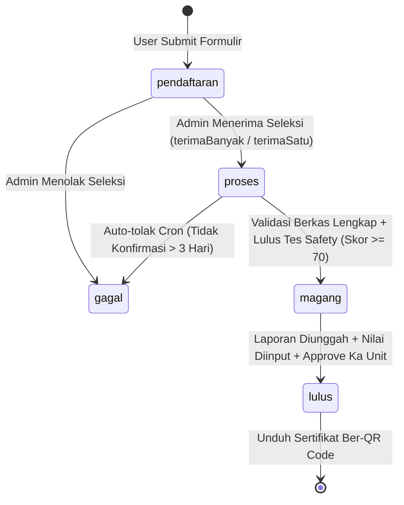

# Pengetahuan Sistem: Aplikasi Magang & Penelitian PT Semen Padang (magangSP)

Dokumen ini merupakan basis pengetahuan (Knowledge Base) arsitektur, algoritma, alur bisnis, dan aturan sistem yang dianalisis secara mendalam untuk repositori ini.

---

## 1. Ringkasan Eksekutif & Tech Stack

Aplikasi **magangSP** adalah sistem informasi komprehensif untuk mengelola siklus hidup program **Magang (Internship)** dan **Penelitian (Research/Skripsi/Tesis)** di lingkungan PT Semen Padang.

### Spesifikasi Teknologi:
- **Framework Core**: CodeIgniter 4 (PHP ^8.2)
- **Autentikasi & RBAC**: Myth/Auth (`myth/auth: dev-develop`)
- **Basis Data**: MySQL (MariaDB/MySQLi driver)
- **PDF Generation**: TCPDF (`tecnickcom/tcpdf` di-wrap oleh `App\Libraries\MY_TCPDF` dan `App\Controllers\GeneratePDF`)
- **QR Code Engine**: Endroid QR Code (`endroid/qr-code ^6.0`)
- **Excel Processing**: PhpSpreadsheet (`phpoffice/phpspreadsheet ^5.1`)
- **Mail Engine**: CodeIgniter Services Email (dengan template HTML otomatis dan tanda tangan digital Unit Diklat/SDM Unit 44)

---

## 2. Aktor & Peran (Roles)

1. **User / Peserta (Mahasiswa & Siswa SMK)**:
   - Registrasi, lengkapi profil biodata, upload berkas (CV, surat permohonan, BPJS Ketenagakerjaan, pas foto).
   - Pengajuan magang atau penelitian dengan memilih unit/jurusan/durasi dan kata kunci (keyword).
   - Konfirmasi penerimaan dalam batas waktu SLA (maksimal 3 hari).
   - Menyetujui Surat Pernyataan Digital.
   - Mengikuti **Safety Induction Online Test** (K3).
   - Mengunduh Tanda Pengenal (ID Card) & Form Absensi.
   - Mengunggah Laporan Akhir & Absensi, mengisi form Feedback.
   - Mengunduh Sertifikat Magang / Surat Keterangan Penelitian ber-QR Code.

2. **Admin (Unit Diklat / SDM - Unit ID 44)**:
   - Pengelolaan Master Data (Instansi, Jurusan, Unit Kerja, Kuota Unit, Mapping Jurusan-Unit, Master Keywords, Soal Safety).
   - Seleksi Pendaftar (Single & Bulk Terima/Tolak).
   - Validasi berkas fisik & kepesertaan BPJS Ketenagakerjaan.
   - Manajemen Kartu RFID (Peminjaman, Pengembalian, Penanganan Denda Kartu Hilang).
   - Penugasan Pembimbing (Mentor) Unit.
   - Finalisasi kelulusan dan penerbitan sertifikat digital.
   - Monitoring & Export rekapitulasi data ke Excel.

3. **Pembimbing / Kepala Unit Kerja**:
   - Pembimbing: Membimbing peserta, memvalidasi absensi dan laporan akhir, serta melakukan **Penilaian Kompetensi** (8 indikator).
   - Kepala Unit Kerja (Eselon 2): Melakukan verifikasi dan persetujuan akhir (*Approval*) peserta magang/penelitian sehingga sertifikat dapat diterbitkan.

---

## 3. Siklus Hidup Peserta (State Machine)

Peserta magang dan penelitian berpindah status melalui status seleksi dan `status_akhir`:



---

## 4. Algoritma & Logika Bisnis Inti

### 4.1. Algoritma Perhitungan Sisa Kuota Dinamis (Dynamic Rolling Quota with 2-Month Cutoff Window)
- **Lokasi Kode**: [`MagangModel::getSisaKuota()`](file:///Users/fernandaep/Projects/magangsp/app/Models/MagangModel.php#L241-L398)
- **Prinsip**: Kuota unit kerja dihitung secara bergulir (*rolling*) berdasarkan tanggal cutoff 2 bulan ke depan (awal bulan 2 bulan mendatang):
  $$\text{CutoffDate} = \text{first day of } (today + 2 \text{ months})$$
- **Pemetaan Jenjang Pendidikan**:
  - `SMK` $\to$ `SMK`
  - `D3`, `D4/S1`, `S2` $\to$ `Perguruan Tinggi`
- **Rumus Sisa Kuota**:
  $$\text{SisaKuota} = \text{Kuota} - \sum (\text{Peserta Diterima})_{\text{status } \in ('proses', 'magang') \land \text{tanggal\_selesai} \ge \text{CutoffDate}}$$
- **Pelacakan Sub-Status**:
  - `jumlah_aktif`: Peserta dengan `status_akhir = 'magang'`, $tanggal\_masuk \le today$ dan $tanggal\_selesai \ge today$.
  - `jumlah_akan_magang`: Peserta dengan `status_akhir = 'magang'`, $tanggal\_masuk > today$.
  - `jumlah_belum_selesai`: Peserta aktif yang melewati $tanggal\_selesai < today$ namun belum difinalisasi.

---

### 4.2. Algoritma Penjadwalan Tanggal Masuk & Business Day Shifting
- **Lokasi Kode**: [`Admin\MagangController::terimaBanyak()`](file:///Users/fernandaep/Projects/magangsp/app/Controllers/Admin/MagangController.php#L512-L536)
- **Penetapan Tanggal Masuk**:
  Tanggal masuk peserta magang ditetapkan pada tanggal 1 dua bulan ke depan dari tanggal pemrosesan seleksi:
  ```php
  $start = new \DateTime($today->format('Y-m-01'));
  $start->modify('+2 month');
  ```
- **Shifting Hari Kerja (Business Day Shift)**:
  Jika tanggal 1 jatuh pada hari Sabtu (ISO 6) atau Minggu (ISO 7), tanggal otomatis digeser ke hari kerja pertama (Senin):
  ```php
  while (in_array($start->format('N'), [6, 7])) {
      $start->modify('+1 day');
  }
  ```
- **Penetapan Tanggal Selesai**:
  Dihitung berdasarkan durasi bulan yang diajukan peserta:
  ```php
  $end = clone $start;
  $end->modify('last day of +' . ($durasi - 1) . ' month');
  ```

---

### 4.3. Algoritma Rekomendasi Unit Penelitian Berbasis Keyword Matching (Bipartite Set Overlap)
- **Lokasi Kode**: [`Admin\PenelitianController::getRekomendasiUnit()`](file:///Users/fernandaep/Projects/magangsp/app/Controllers/Admin/PenelitianController.php#L162-L204)
- **Prinsip**: Mencocokkan himpunan kata kunci penelitian yang diajukan pendaftar ($K_{penelitian}$) dengan kata kunci kompetensi/kebutuhan unit kerja ($K_{unit}$):
  $$\text{MatchScore}(unit) = | K_{unit} \cap K_{penelitian} |$$
- **Implementasi Query**:
  ```sql
  SELECT
      uk.unit_id,
      uk.unit_kerja,
      COUNT(DISTINCT pkmatch.keyword_id) AS match_count,
      GROUP_CONCAT(DISTINCT CASE WHEN pkmatch.keyword_id IS NOT NULL THEN k.keyword_nama END SEPARATOR ', ') AS matched_keywords
  FROM unit_kerja uk
  LEFT JOIN unit_keyword ukw ON uk.unit_id = ukw.unit_id
  LEFT JOIN keyword k ON k.keyword_id = ukw.keyword_id
  LEFT JOIN penelitian_keyword pkmatch ON pkmatch.keyword_id = ukw.keyword_id AND pkmatch.penelitian_id = ?
  GROUP BY uk.unit_id
  ORDER BY match_count DESC, uk.unit_kerja ASC;
  ```
  Sistem mengurutkan rekomendasi unit kerja mulai dari jumlah kesesuaian kata kunci terbanyak.

---

### 4.4. Algoritma Tes Induksi K3 (Safety Induction Online Test) & Daily Rate Limiting
- **Lokasi Kode**: [`User\MagangController::submitTes()`](file:///Users/fernandaep/Projects/magangsp/app/Controllers/User/MagangController.php#L388-L468) & [`User\PenelitianController::submitTes()`](file:///Users/fernandaep/Projects/magangsp/app/Controllers/User/PenelitianController.php#L411-L484)
- **Rate Limiting**: Maksimal 3 kali percobaan per hari kalender:
  $$\text{Count}(Percobaan_{today}) < 3$$
- **Pembobotan Dinamis & Penilaian**:
  $$\text{NilaiPerSoal} = \frac{100}{N_{total\_soal}}$$
  $$\text{Skor} = \text{round}\left( \sum_{i=1}^{N} [\text{jawaban}_i == \text{kunci}_i] \times \text{NilaiPerSoal} \right)$$
- **Passing Grade**:
  $$\text{Status} = \begin{cases} \text{"lulus"}, & \text{jika Skor} \ge 70 \\ \text{"gagal"}, & \text{jika Skor} < 70 \end{cases}$$
  Hanya peserta yang berstatus `lulus` yang berhak melanjutkan ke pencetakan Tanda Pengenal dan pelaksanaan program.

---

### 4.5. Algoritma Penilaian Kinerja 8 Aspek & Penentuan Predikat Kelulusan
- **Lokasi Kode**: [`Pembimbing\MagangController::save()`](file:///Users/fernandaep/Projects/magangsp/app/Controllers/Pembimbing/MagangController.php#L497-L565) & [`Admin\MagangController::cetakSertifikat()`](file:///Users/fernandaep/Projects/magangsp/app/Controllers/Admin/MagangController.php#L3555-L3573)
- **Parameter Kompetensi (Skala Diskrit 60, 70, 80, 90, 100)**:
  1. Disiplin
  2. Kerajinan
  3. Tingkah Laku
  4. Kerja Sama
  5. Kreativitas
  6. Kemampuan Kerja
  7. Tanggung Jawab
  8. Penyerapan
- **Perhitungan Rata-rata**:
  $$\bar{X} = \frac{1}{8} \sum_{i=1}^{8} N_i$$
- **Tabel Konversi Kategori Predikat**:
  | Rentang Rata-Rata ($\bar{X}$) | Predikat Huruf | Predikat Keterangan |
  | :--- | :---: | :--- |
  | $\bar{X} \ge 90$ | A | **Baik Sekali** |
  | $80 \le \bar{X} < 90$ | B | **Baik** |
  | $70 \le \bar{X} < 80$ | C | **Cukup** |
  | $60 \le \bar{X} < 70$ | D | **Kurang** |
  | $\bar{X} < 60$ | E | **Sangat Kurang** |

---

### 4.6. Algoritma Penomoran Sertifikat & QR Code Verification
- **Lokasi Kode**: [`Admin\MagangController::cetakSertifikat()`](file:///Users/fernandaep/Projects/magangsp/app/Controllers/Admin/MagangController.php#L3584-L3710)
- **Penomoran Berurutan Per Tahun**:
  Mengambil nomor tertinggi pada tahun berjalan dan menambah 1 ($nomor = nomor_{last} + 1$).
- **Format Penomoran**:
  $$\text{Format: } \mathbf{[NoUrut:4digit]/MAGANG/SP/[Bulan:2digit].[Tahun:4digit]}$$
  *Contoh*: `0042/MAGANG/SP/11.2026`
- **Kriptografi Token QR**:
  Menggunakan CSPRNG (*Cryptographically Secure Pseudo-Random Number Generator*):
  ```php
  $qrToken = bin2hex(random_bytes(20)); // Menghasilkan 40 karakter hex unik
  ```
- **Integrasi QR Code**:
  Direncanakan dengan logo Semen Padang di tengah (`logoPunchoutBackground = true`), mengarah ke endpoint validasi publik `base_url('sertifikat/verify/' . $qrToken)`.

---

### 4.7. Algoritma Lifecycle Kartu RFID & Pengenaan Denda
- **Lokasi Kode**: [`Admin\MagangController::setRFID()`](file:///Users/fernandaep/Projects/magangsp/app/Controllers/Admin/MagangController.php#L2445-L2524)
- **Status Mesin RFID**:
  - `available` (Tersedia di pool)
  - `assigned` (Sedang dipinjam peserta)
  - `returned` (Dikembalikan setelah magang selesai)
  - `lost` (Kartu hilang)
- **Aturan Denda Kehilangan**:
  Jika status dikembalikan sebagai `lost`, sistem mengaktifkan `denda_bayar = 1`, mencatat `tanggal_bayar = NOW()`, menandai kartu lama sebagai `lost`, serta menerbitkan penugasan RFID baru pengganti.

---

### 4.8. Algoritma Otomasi Cron Job (SLA Enforcement)
- **Lokasi Kode**: [`App\Controllers\CronController`](file:///Users/fernandaep/Projects/magangsp/app/Controllers/CronController.php), [`App\Services\ProgramCronService`](file:///Users/fernandaep/Projects/magangsp/app/Services/ProgramCronService.php), dan CLI Runner [`App\Commands\RunCron`](file:///Users/fernandaep/Projects/magangsp/app/Commands/RunCron.php).
- **Eksekusi Produksi**: Menggunakan Spark CLI Command (`php spark cron:run [job_name]`) untuk mencegah 504 Gateway Timeout dan batasan web server. Deployment otomatis diatur via [`deploy.sh`](file:///Users/fernandaep/Projects/magangsp/deploy.sh).
- **Jadwal & Aksi**:
  1. `[07:00] auto-tolak`: Membatalkan pendaftaran peserta yang telah diterima seleksi namun tidak melakukan konfirmasi dalam kurun waktu $\ge 3$ hari ($tanggal\_seleksi \le today - 3\text{ hari}$).
  2. `[09:00] remind-pembimbing`: Mengirim reminder kepada unit kerja jika tanggal masuk peserta telah lewat ($tanggal\_masuk < today$) namun pembimbing belum ditetapkan (`pembimbing_id IS NULL`).
  3. `[09:10] remind-unit`: Mengirim email reminder ke pimpinan unit kerja H-3 sebelum peserta mulai magang/penelitian ($tanggal\_masuk = today + 3\text{ hari}$).
  4. `[10:00] remind-laporan`: Mengingatkan peserta yang telah selesai program ($tanggal\_selesai \le today$) hingga batas waktu maksimal 15 hari pasca selesai untuk segera mengunggah laporan dan form absensi.
  5. `[14:00] email-akhir`: Mengirim email ucapan selesai dan permohonan pengisian form feedback pada hari terakhir program ($tanggal\_selesai = today$).
  6. `[16:00] remind-berkas`: Mengingatkan peserta pada interval hari H-7, H-6, H-5, H-4 jika berkas BPJS Ketenagakerjaan belum diunggah.

---

## 5. Struktur Basis Data Kunci

| Tabel | Fungsi Utama |
| :--- | :--- |
| `users` | Akun pengguna, data diri, NISN/NIM, jenjang pendidikan, kontak, berkas CV/surat/BPJS |
| `magang` | Transaksi kepesertaan magang, status seleksi, tanggal masuk/selesai, pembimbing, approval |
| `penelitian` | Transaksi kepesertaan penelitian/riset, judul penelitian, unit penempatan, pembimbing |
| `unit_kerja` | Master unit kerja / departemen di PT Semen Padang, email pimpinan unit |
| `kuota_unit` | Kuota per unit kerja yang dipisahkan berdasarkan tingkat pendidikan (SMK / Perguruan Tinggi) |
| `jurusan` | Master program studi / jurusan |
| `jurusan_unit` | Relasi pemetaan jurusan apa saja yang dapat diterima oleh masing-masing unit kerja |
| `keyword` | Master kata kunci bidang keilmuan / topik penelitian |
| `unit_keyword` | Mapping kata kunci relevan untuk masing-masing unit kerja |
| `penelitian_keyword` | Kata kunci yang dilampirkan oleh pemohon penelitian untuk rekomendasi unit |
| `penilaian` | Lembar penilaian 8 aspek kompetensi oleh pembimbing unit |
| `sertifikat_magang` | Arsip sertifikat digital, nomor urut tahunan, dan token verifikasi QR |
| `surat_keterangan` | Arsip surat keterangan selesai untuk program penelitian |
| `soal_safety` | Bank soal tes pemahaman keselamatan kerja (K3 Induction) |
| `jawaban_safety` | Riwayat skor tes safety, tanggal ujian, dan nomor percobaan harian |
| `rfid` & `rfid_assignment` | Master tag kartu RFID fisik dan riwayat peminjaman/kehilangan kartu |
| `feedback` & `feedback_penelitian` | Formulir survei evaluasi kepuasan peserta terhadap unit dan fasilitas magang |
